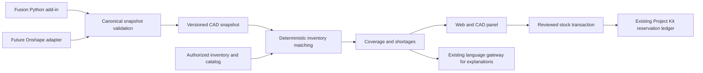

# FindEZ CAD Intelligence: technical implementation specification

Status: Phase 0 discovery complete. A subsequent read-only Fusion prototype is
documented in [the implementation receipt](docs/plans/cad-intelligence/PROTOTYPE.md).
The read-only preview is [deployed](docs/plans/cad-intelligence/PRODUCTION_RELEASE.md).
The full architecture below remains the target specification, not a claim that
every capability is implemented.
Audit date: 2026-11-10. First customer platform: **Autodesk Fusion 360**, confirmed
by Tanya during this audit. Onshape is the second adapter. Work is organized by
acceptance gates, not calendar estimates.

## 1. Decision and scope

Build a Fusion Python add-in that extracts the currently open assembly, submits a
versioned BOM to the existing FastAPI backend, and displays an inventory comparison
in a docked FindEZ panel. Provide the same results in the authenticated `/cad` web
experience. Keep Supabase Auth, the existing PostgreSQL database, inventory access
rules, and Project Kit reservation ledger.

The first acceptance gate is a real team-owned robotics assembly, independently
counted by the team, extracted through Fusion and compared against an explicitly
selected FindEZ inventory. A screenshot or fabricated demonstration BOM does not
pass this gate. No real assembly or authenticated CAD API was exercised in Phase 0.

Do not create a second stock-allocation ledger. Existing `project_kits`,
`project_kit_items`, `project_kit_reservations`, and
`replace_project_kit_reservations` already implement much of that concept. Extend
their transaction boundary in a later, separately reviewed implementation phase.
The proposed `inventory_allocations` concept is a CAD read projection over those
reservations, not another source of available stock.

V1 includes connection, snapshot extraction, reviewable matches, shortages,
purchasing-list export and analysis history. Allocation architecture is specified
now, but writes remain disabled until the shared stock transaction gate passes.
V2 adds safe allocation/consumption, evidence-backed alternatives and Assist tools.
V3 may add transient CAD highlighting and geometry comparisons. Never infer
engineering fitness from an inventory percentage or visual resemblance.

The Phase 0 documentation delivery changed no production application, mobile,
inventory schema, environment or deployment configuration. Draft SQL is in
[`docs/plans/cad-intelligence/drafts/`](docs/plans/cad-intelligence/drafts/README.md),
outside migration discovery, with an unconditional execution guard. It has not
been applied to any database.

## 2. Audit evidence and version boundaries

The monorepo has independent release branches and production overlays. A single
Git SHA does not describe all deployed code. Evidence used:

| Evidence | Revision / observation |
| --- | --- |
| Backend audit base | `17632a92`, `fix/barcode-camera-lookup-217`; this documentation lane branches from it |
| Current production checkout | `/home/ubuntu/findez`, HEAD `98597c3`; not treated as a clean runtime manifest |
| Live backend service | Working directory `/home/ubuntu/findez/backend`; Python **3.12.3**, not the proposed 3.13 |
| Live PostgreSQL | **17.6**, self-hosted Supabase |
| Live web | `/home/ubuntu/findez-commerce-20261110/candidate/frontend`, a deployment artifact without Git metadata |
| Web package declaration | Next `^16.3.8`, React `19.2.3`, Tailwind 4, TypeScript 5; these are declarations, not a claim about resolved versions |
| Schema verification | Read-only public-schema dump; SHA256 `7c5f252b676abef9aed159d274355093bf87e55736a1fda959f0dbe0cdf6ceaf` |

Live and local hashes agree for `project_kits_service.py`, `project_kits.py`,
`core/auth.py`, and `catalog_service.py`. Live `items_repo.py` differs: it disables
process-local stock caching for authenticated actors and normalizes old purchase
sources. Preserve these live fixes when implementing. The current deployed web
has newer shell and commerce code than the audit branch. Rebase future production
work against its actual source lane; do not replace the deployment with this branch.

Live `inventory_scope.py` also adds `chat_space_id` / `chat_space_name`, Space-bound
item/conversation filters, cache keys and write checks. Preserve this deployed
boundary. Inventory-wide CAD tools must not escape a Space chat's selected scope;
make those tools unavailable there until a separately designed scoped contract
exists. Ordinary inventory-level Assist can expose authorized CAD project results.

Production schema metadata was read; no customer inventory rows, credentials,
tokens or CAD files were retrieved. The full schema snapshot stays outside Git.
The repository's August baseline alone is insufficient to reconstruct production.
No `cad_*` or `inventory_allocations` relation was found in the live public schema.

### 2.1 Current backend and ownership

| Existing source | Responsibility and integration consequence |
| --- | --- |
| `backend/app/main.py`, `api/router.py` | FastAPI creation, error handling and router registration. New CAD routes belong here, not a separate server. |
| `core/auth.py` | `AuthenticatedUser`, `get_current_user`; verifies self-hosted HS256 and JWKS ES256/RS256 tokens and binds request actor. Keep both paths. |
| `services/supabase_client.py` | Server-only service client, wrapped by resource and inventory guards. Service role bypasses RLS; explicit authorization remains mandatory. |
| `api/routes/inventory_workspaces.py` | `_inventory` validates inventory plus workspace membership and content role; authorized scoped routes live under `/inventories/{inventory_id}`. |
| `services/inventory_scope.py` | ContextVar scope, inventory filters, parent checks, RPC allowlist. New table names are NOT automatically protected. |
| `services/resource_access.py`, `permissions.py` | Actor/resource fences and role semantics; raw Supabase access is not an authorization shortcut. |
| `services/items_repo.py`, `spaces_repo.py`, `bins_repo.py` | Item operations and persistent Space identity. Keep moves/Space creation in the existing repository/transaction path. |
| `api/routes/imports.py` | CSV/XLSX BOM parser and `/inventory/bom/analyze`; integer requirements, deterministic identifier/name matching. |
| `services/project_kits_service.py`, `api/routes/project_kits.py` | Kits, readiness, per-item shared reservation accounting and reserve/release RPC. |
| `services/catalog_service.py` | Barcode aliases, manufacturer-verified catalog enrichment and published compatibility keys. Reuse evidence, not unverified claims. |
| `services/world_item_changes.py`, `world_direct_actions.py` | Reviewed/idempotent stock actions and current-record checks; SQL counterparts own atomic writes. |
| `api/routes/checkouts.py` | Active checkout records; current route inserts a checkout without decrementing `items.quantity`. |
| `services/ai_agent.py`, `agent_gateway_client.py` | Existing language gateway and authorized tools including `project_kit_readiness`. |
| `services/photo_extraction.py`, `find_pipeline.py`, `glm_extraction.py` | Photo extraction, separate from structured CAD extraction and chat reasoning. |

SQL functions and guards must be reviewed alongside Python. In particular,
`findez_inventory_role(inventory, actor)` is the strict inventory-content role
helper. **Do not use `findez_inventory_policy` as the sole permissive CAD read
policy**: it deliberately returns true for some legacy personal inventories,
relying on additional existing owner policies. Copying it alone would expose CAD
records. Proposed CAD RLS uses the strict role helper and disallows public API-key
claims until an explicit CAD API-key contract exists.

### 2.2 Existing schema and quantity semantics

| Existing relation | Observed keys / fields relevant to CAD |
| --- | --- |
| `app_inventories` | UUID `inventory_id` PK, `owner_user_id`, nullable `team_id`, access mode, default role, directory visibility |
| `teams` | UUID `team_id` PK; optional `organization_id`; workspace membership and organization administration are distinct |
| `app_inventory_members` | `(inventory_id,user_id)`, explicit roles including `none`, `permission_revision` |
| `items` | UUID `item_id` PK; integer `quantity`; `inventory_id`, `space_id`, legacy `location`, `bin_id`, `user_id`, `brand`, `part_number`, `barcode`, `catalog_id`, `import_data`, source/external IDs |
| `spaces` | UUID `id`, inventory and optional physical-location association; real persistent table, contrary to the old skill note |
| `project_kits` | UUID `id`; inventory, owner, creator, legacy share/location, name |
| `project_kit_items` | UUID `id`, `kit_id`, positive integer `required_quantity`, name/part number/brand, inventory |
| `project_kit_reservations` | UUID `id`, kit and kit-line IDs, `inventory_item_id`, positive integer quantity, creator and inventory |
| `checkouts` | UUID `checkout_id`, item/inventory, quantity, active/returned state |
| `parts_catalog`, `part_catalog_barcodes` | Catalog identity, barcode aliases, verification status, specifications, compatibility and source URLs |
| `item_events`, `app_access_audit` | Existing usage/restock events and actor-attributed changes; event types are constrained, so do not invent a `cad_consumed` event type |
| `app_reorder_requests` | Receiving is distinct from ordering; ordering does not prove physical stock |

`items.workspace_id` belongs to the integration/API-key model and must not be
confused with `app_inventories.inventory_id`, `teams.team_id`, or a CAD workspace.
CAD v1 binds one project to one actual inventory. Organization-wide multi-inventory
projects require an explicit future project-scope model and per-source permissions.
Membership in an organization is not itself permission to read every inventory.

There are no universal inventory columns for quantity unit, physical verification,
damaged stock or a product variant/SKU. Imported fields and photo evidence can be
incomplete. Some accepted photo counts are placeholders; negative/unknown legacy
quantities must not become available units. Catalog verification verifies product
identity, not how many usable physical units a user owns.

Existing kit matching removes punctuation from identifiers and can match names
when a part number is absent. It does not establish manufacturer/variant identity.
Its readiness percentage counts ready lines, whereas the proposed CAD coverage
counts covered units. Preserve the existing API and label these as different
metrics. Kit analysis already prevents reusing units across duplicate lines in
one request; CAD matching must retain that invariant.

The live reservation RPC locks requested item rows and checks other kit
reservations. It does not serialize the kit header first, account for active
checkouts, verify usable stock, or provide a complete cross-writer consumption
protocol. Ordinary quantity edits can invalidate previous reservations. These are
specific blockers to claiming fully protected CAD allocation today, not changes
made during this audit.

### 2.3 Web, commerce, deployment and tests

Web pages use `frontend/src/app/(workspace)`, `ProtectedAppPage` / `requireUser`,
`InventoryBoundary`, `AppShell`, `app-sidebar.tsx`, and `lib/api.ts`. The live layout
also uses `PageTransition`. Inventory-aware links and API routing live in
`lib/inventory-selection.ts` and related boundary components; adding `/cad` requires
deliberate route classification. Keep the selected account/inventory captured for
async work; discard responses after a switch. `use-app-theme` and existing CSS
tokens/components supply theme and presentation, rather than a new UI system.

The live web already includes `/connect/amazon` and `/connect/shopify`. Live
`backend/app/services/commerce/` and `api/routes/commerce.py` use actor-private,
inventory-bound connections, encrypted credential handling, leases and reviewed
imports. Live tables include `commerce_connections` and `commerce_source_records`.
These explicitly have **no physical-stock effect**. Amazon consumer CSV import and
merchant OAuth are different capabilities; consumer cart/purchasing is not
implemented. Reuse reviewed security patterns where suitable; never let CAD
shortages auto-purchase or count remote merchant stock as owned stock.

Production is self-hosted: Caddy/nginx, systemd FastAPI/Next.js, Docker Supabase.
Configuration is in backend settings and server environment; browser
`NEXT_PUBLIC_*` configuration is build-time. No new server/queue/cloud provider is
assumed. Any eventual durable worker is a separate rollout decision. Initially
use bounded synchronous deterministic analysis; support large work only after
durable leased jobs are deployed. Do not pretend FastAPI `BackgroundTasks`
survives a process restart.

Testing infrastructure: pytest/conftest with external services stubbed; Jest and
Testing Library; Flutter tests/analyzer; connector tests; PostgreSQL 17 RLS and
concurrency fixtures; GitHub Actions. `Makefile` exposes `test-backend`,
`test-frontend`, `test-mobile`, `test-integrations`, and `test-coverage`.
Relevant existing checks include inventory scope, catalog barcode/verified-part,
spreadsheet/BOM import and SQL `api_key_rls.sql` tests. Do not run SQL fixtures on
production. This Phase 0 is documentation-only: no claim of CAD runtime test passes.

## 3. Platform feasibility and verified API surface

Official documentation was checked on the audit date. "Documented" below means
the API exists in the cited reference, not that it was tested with the team's
account, subscription, files or installed Fusion release.

| Concern | Fusion desktop: first platform | Onshape: second platform |
| --- | --- | --- |
| Delivery | Python add-in on the user's desktop, docked HTML palette | Hosted HTTPS extension in an element right panel |
| CAD access | Already-open design under the user's Fusion session | Backend REST calls with user's Onshape OAuth grant |
| FindEZ login | Existing Supabase identity; browser-assisted desktop authorization | Existing Supabase identity plus separate provider OAuth consent |
| Assembly extraction | Traverse root occurrences recursively | Assembly definition and BOM REST reads |
| Versioning | Saved DataFile version plus active config; dirty session explicitly separate | Document/version or immutable microversion plus configuration |
| Main constraint | Desktop runtime/version behavior and real assemblies need testing | Developer registration, scopes, call budgets and account permissions |
| First-customer fit | Confirmed by Tanya | No first-team adoption requirement established |

### 3.1 Fusion API mapping

Use Python for the first add-in and a manifest, not experimental TypeScript APIs.
The add-in's embedded Python is not the backend interpreter; test its supported
runtime on both Windows and macOS. Installation and manifests are described in
[Creating a Script or Add-In](https://help.autodesk.com/cloudhelp/ENU/Fusion-360-API/files/WritingDebugging_UM.htm).

| Requirement | Exact documented API / handling |
| --- | --- |
| Active design | `adsk.core.Application.get().activeProduct`, `adsk.fusion.Design.cast(...)`, `Design.rootComponent` |
| Nested occurrences | Walk `rootComponent.occurrences` then `Occurrence.childOccurrences` in context. Autodesk supplies a [recursive traversal sample](https://help.autodesk.com/cloudhelp/ENU/Fusion-360-API/files/AssemblyTraversalUsingRecursion_Sample.htm). |
| Definition vs placement | `Occurrence.component` references a `Component`; `Component.allOccurrences` is already flattened. Choose one traversal, never sum both. [Component reference](https://help.autodesk.com/cloudhelp/ENU/Fusion-360-API/files/fusion_Component.htm) |
| Names and placement | `Occurrence.fullPathName`, `assemblyContext`, `documentReference`, `isReferencedComponent`, `isVisible` and `isLightBulbOn`. Paths are snapshot locators, not permanent IDs. [Occurrence reference](https://help.autodesk.com/cloudhelp/ENU/Fusion-360-API/files/fusion_Occurrence.htm) |
| Persistent resolution | Preserve `entityToken` as an opaque locator; resolve using `Design.findEntityByToken`. Token strings can change and must not be compared as identity. [Token contract](https://help.autodesk.com/cloudhelp/ENU/Fusion-360-API/files/fusion_Occurrence_entityToken.htm) |
| Metadata | `Component.name`, `partNumber`, `description`, `attributes`; manufacturer/SKU/GTIN require mapped user properties or explicit review. A default part number may be the component name, not a supplier identifier. [Component reference](https://help.autodesk.com/cloudhelp/ENU/Fusion-360-API/files/fusion_Component.htm) |
| Material | `Component.material`; preserve assigned material as CAD metadata, not a certification of the physical item. [Material property](https://help.autodesk.com/cloudhelp/ENU/Fusion-360-API/files/fusion_Component_material.htm) |
| Dimensions | Optional bounding box/physical properties, with measurement method and frame; not inferred thread/load specifications. Design database lengths are cm, angles radians and mass kg; convert explicitly. [Units guide](https://help.autodesk.com/cloudhelp/ENU/Fusion-360-API/files/Units_UM.htm) |
| Configurations | `Design.configurationTopTable`, `isConfiguredDesign`, occurrence `configurationRow` / `configuredDataFile`. Read active configuration; don't switch it silently. Some newer configuration APIs are preview. [Configuration guide](https://help.autodesk.com/cloudhelp/ENU/Fusion-360-API/files/Configurations_UM.htm) |
| Suppression | Read available timeline suppression and ancestor state. `TimelineObject.isSuppressed` exists; an occurrence is suppressed through its creating timeline entry. Do not invent `Occurrence.isSuppressed` from memory. Unsupported direct-design/config cases become incomplete, not silently included. [Timeline property](https://help.autodesk.com/cloudhelp/ENU/Fusion-360-API/files/fusion_TimelineObject_isSuppressed.htm), [Design suppression semantics](https://help.autodesk.com/cloudhelp/ENU/Fusion-360-API/files/fusion_Design_setSuppressed.htm) |
| Document/version | `Document.dataFile`, `DataFile.id`, `versionId`, `versionNumber`, referenced file versions and cloud processing status. New/unsaved data may lack a cloud identity. [DataFile reference](https://help.autodesk.com/cloudhelp/ENU/Fusion-360-API/files/core_DataFile.htm) |
| Unsaved edits | `Document.isModified`; use a session snapshot ID plus content hash and label "Unsaved design". Never claim saved version N describes dirty geometry. [Modified property](https://help.autodesk.com/cloudhelp/ENU/Fusion-360-API/files/core_Document_isModified.htm) |

Autodesk's [ExtractBOM sample](https://github.com/AutodeskFusion360/ExtractBOM)
confirms a traversal-based BOM path. It is an example, not proof that every team
assembly's manufacturing quantities, suppression, purchased subassemblies or
configurations are handled correctly. Our counts must pass the fixtures below.

Create the UI with `UserInterface.palettes.add`, `Palette.incomingFromHTML`, and
`sendInfoToHTML` / `adsk.fusionSendData`. HTML JavaScript cannot directly call the
Fusion API. Recreate the palette after workspace switches and invalidate document
state after an active-document change. [Palette guide](https://help.autodesk.com/cloudhelp/ENU/Fusion-360-API/files/Palettes_UM.htm)

Read Fusion objects on its main thread; copy validated plain data before network
work. Use background network I/O and custom events to return results; do not call
CAD APIs from a worker or hold Fusion in a long polling loop. [Threading guide](https://help.autodesk.com/cloudhelp/ENU/Fusion-360-API/files/Threading_UM.htm)

No Autodesk OAuth application is needed simply to run a local add-in against the
open document. That does not grant a backend cloud access or bypass Autodesk
licensing. Pilot installation can be manual; marketplace distribution needs
publisher setup, bundle/manifest, compatible builds and review. [Installation](https://www.autodesk.com/support/technical/article/caas/sfdcarticles/sfdcarticles/How-to-install-an-ADD-IN-and-Script-in-Fusion-360.html),
[publisher requirements](https://aps.autodesk.com/marketplace/publisher-center/fusion-publisher-guidelines).

**Cloud Fusion is a separate option, not an unavailable capability.** Autodesk
announced Manufacturing Data Model v3 generally available with BOM and design-state
capabilities. [Official GA announcement](https://aps.autodesk.com/blog/design-make-data-powering-future-heres-what-au-2025-revealed).
APS requires a registered app and appropriate user authorization; its authentication
API supports three-legged authorization and PKCE. [APS authentication](https://aps.autodesk.com/developer/overview/authentication-api).
Autodesk also documents the public GraphQL endpoint
`https://developer.api.autodesk.com/mfg/v3/graphql/public` and three-legged
authorization for its custom-property workflow. This verifies the endpoint, not
a complete BOM query contract. [Official custom-property walkthrough](https://aps.autodesk.com/blog/custom-properties-fusion).
The detailed MFGDM reference did not render readable schema in this audit. Exact
GraphQL operations, hub eligibility, pagination, entitlements and request budgets
remain unverified; do not fabricate a cloud BOM endpoint or make this an MVP
dependency. Subscription/access rules also require account-specific validation.
[Current access guidance](https://aps.autodesk.com/blog/data-model-apis-included-subscriptions-plus-flexible-ways-scale).
Local occurrence reads have no documented HTTP requests-per-minute quota in the
desktop references; measure UI work and bound payload size instead. This is not a
claim that APS or cloud operations are unlimited.

### 3.2 Onshape exact capabilities and limits

The official generated client currently documents base `/api/v16`, while the
assembly tutorial still demonstrates v9. Pin and contract-test a supported API
version at implementation time; do not mix schemas. Verified paths (relative to
the pinned API base):

| Method and path | Purpose / caveat |
| --- | --- |
| `GET /assemblies/d/{did}/{wvm}/{wvmid}/e/{eid}` | Definition, parts/subassemblies and occurrences; configuration and `excludeSuppressed` options |
| `GET /assemblies/d/{did}/{wvm}/{wvmid}/e/{eid}/bom` | BOM; `indented`, `multiLevel`, `includeExcluded`, `generateIfAbsent`, item-microversion and subassembly-behavior options |
| `POST /assemblies/d/{did}/w/{wid}/e/{eid}/bomelement` | Creates/gets BOM element; do NOT use a document-mutating endpoint for a read-only integration |

These are verified in the [official Assembly API client reference](https://github.com/onshape-public/go-client/blob/master/onshape/docs/AssemblyApi.md).
For a BOM absent from the document, validate `generateIfAbsent=true` behavior on
the chosen version/account before relying on it. Preserve excluded rows as evidence
but omit them from requirements. Honor purchased/subassembly BOM behavior; do not
sum structured parents and flattened leaves.

Part metadata is available through `GET /metadata/d/{did}/{wvm}/{wvmid}/e/{eid}/{iden}/{pid}`
(`iden=p` for a part), and element metadata through the corresponding element path.
Preserve property IDs and typed values rather than assume every account exposes
the same manufacturer/SKU fields. [Official Metadata API reference](https://github.com/onshape-public/go-client/blob/master/onshape/docs/MetadataApi.md),
[metadata example](https://onshape-public.github.io/docs/api-adv/metadata/).
Configuration definitions/encodings are documented separately; resolve the actual
parameter IDs and canonical values instead of interpreting only a display label.
[Configuration guide](https://onshape-public.github.io/docs/api-adv/configs/).

Onshape occurrence paths identify placements; referenced definitions need document,
element, part ID, configuration and source revision. A mutable workspace is not a
revision. Pin an immutable version/microversion and retain linked-document revision
information. Transforms from assembly definitions are absolute in root coordinates,
so do not multiply them again as relative transforms. [Assembly guide](https://onshape-public.github.io/docs/api-adv/assemblies/)

Register a provider OAuth app with exact callback URI and least-privilege read
scope, using `https://oauth.onshape.com/oauth/authorize` and
`https://oauth.onshape.com/oauth/token`. Protect state, refresh and revocation;
provider tokens stay on the backend. Onshape App Store distribution requires
OAuth. Development app registration/assignment and public listing are different
steps. [OAuth](https://onshape-public.github.io/docs/auth/oauth/),
[app registration and distribution](https://onshape-public.github.io/docs/app-store/).

An actual **Element right panel extension** supports assembly context and supplies
document, workspace/version, element, occurrence-path and configuration parameters.
It is an HTTPS iframe, not arbitrary injection into Onshape's UI.
[Extension locations](https://onshape-public.github.io/docs/app-dev/extensions/).
Use documented `applicationInit`/selection messages with exact origin and context
validation. Selection support does not prove arbitrary component recoloring;
native overlay remains a separate spike. [Right-panel messages](https://onshape-public.github.io/docs/app-dev/messages/element-right-panel/).

Onshape does not publish fixed per-endpoint rate windows; honor 429, remaining
budget headers and retry timing, with bounded backoff/jitter and cancellation.
[Response-code guidance](https://onshape-public.github.io/docs/api-adv/errors/).
Annual API allowances vary by account and app ownership; current docs list 2,500
for Free/Standard/EDU Student, among other tiers. Check the actual app owner's
allowance rather than assuming every robotics team has unlimited calls.
[API limits](https://onshape-public.github.io/docs/auth/limits/).

## 4. Target architecture and module boundaries



Proposed files (all are future work unless listed in section 2):

```text
integrations/findez-fusion/          # Python add-in, manifest, packaged panel
backend/app/api/routes/cad.py       # provider/account/device authorization
backend/app/api/routes/cad_projects.py
backend/app/schemas/cad.py
backend/app/services/cad/
  repository.py                    # explicit inventory/actor fencing
  schemas.py                       # canonical validation and version upgrades
  normalization.py                 # occurrence-to-requirement projection
  matching.py                      # deterministic evidence and candidates
  analysis.py                      # immutable stock snapshot + assignment
  allocations.py                   # adapter to existing kit ledger
  compatibility.py                 # phase 2, evidence-only comparison
  providers/base.py
  providers/fusion.py               # validates pushed snapshots; not adsk runtime
  providers/onshape.py              # future authorized API pull
backend/tests/cad/
frontend/src/components/cad/
frontend/src/app/(workspace)/cad/
```

Connector interface: provider capabilities, validate source, normalize snapshot,
source locators, connection status and errors. Fusion extraction runs in Fusion,
not on the Linux backend; Onshape extraction runs on the server. Neither adapter
may write inventory, reserve stock, choose a destination or invoke model-selected
SQL. Reuse existing catalog and inventory services after authorization.

## 5. Canonical BOM contract v1

Wire decimal values are strings, not floating-point quantities. UUIDs are FindEZ
identities; provider IDs are opaque strings. Names are never identity keys.

| Object | Required fields and meaning |
| --- | --- |
| Envelope | `schema_version:1`, provider (`fusion`/`onshape`), adapter and host versions, extraction UUID, capture time, completeness and warnings |
| Document | External document ID or unsaved-session UUID, name, optional authorized source URL, provider hub/workspace locator |
| Assembly | Snapshot-local assembly key, root definition key, selected configuration (ID, label, canonical values, hash) |
| Revision | Kind (`saved_version`, `microversion`, `unsaved_session`), opaque ID, optional version number, dirty flag and source hash |
| Definition | Snapshot-local definition key, source document/element/part/revision/configuration, name, identifiers with namespaces and provenance |
| Occurrence | Snapshot-local occurrence key, definition key, parent occurrence key, full source path, opaque instance/token, transform with frame/unit, suppression/visibility/exclusion status |
| Requirement | Stable-in-snapshot line key, definition key, occurrence-key references, decimal quantity/unit, counting mode, procurement policy, critical flag and metadata quality |
| Properties | Part number/manufacturer/SKU/GTIN when present; dimension values/unit/tolerance/method; material; namespaced custom properties and raw values |
| Source evidence | Raw bounded extraction metadata, unavailable references, source field paths, adapter version, source revision and hash; no auth headers/tokens |

Example is illustrative, not a Fusion API response (full schema types above apply):

```json
{
  "schema_version": 1,
  "provider": "fusion",
  "extraction_id": "b3b5872a-5f62-493a-8a7a-3acfbcfa4b73",
  "document": {"external_id": "example-document", "name": "Drive assembly"},
  "revision": {"kind": "saved_version", "id": "example-version-7", "dirty": false},
  "assembly": {"key": "root", "configuration": {"id": "standard", "values": {}}},
  "definitions": [{"key": "motor-def", "name": "Motor", "identifiers": [{"kind": "mpn", "namespace": "example-manufacturer", "value": "M-17", "source": "mapped_property"}]}],
  "occurrences": [
    {"key": "o1", "definition_key": "motor-def", "parent_key": null, "path": ["Motor:1"], "suppressed": false},
    {"key": "o2", "definition_key": "motor-def", "parent_key": null, "path": ["Motor:2"], "suppressed": false}
  ],
  "requirements": [{"key": "r1", "definition_key": "motor-def", "occurrence_keys": ["o1", "o2"], "quantity": "2", "unit": "each", "counting_mode": "occurrences", "critical": true}],
  "completeness": "complete",
  "warnings": []
}
```

### Counting and identity invariants

1. Traverse the actual occurrence tree once, preserving every parent path. Two
   placements of one subassembly create two sets of child occurrences. A definition
   cache avoids rereading metadata, **not** counting placements.
2. For two gearbox placements containing four screws each, output eight screws.
   Do not add two gearboxes to that count unless those assemblies are explicit
   purchased units; for a purchased gearbox, stop procurement expansion beneath it.
3. Count leaf occurrences in `occurrences` mode. For a provider's aggregated BOM,
   declare `provider_aggregate` and retain the aggregate row references. Do not
   multiply already-expanded occurrence counts by subassembly quantity again.
4. Suppressed ancestors suppress all descendants. Hidden/isolated is a display
   property, not exclusion. Preserve excluded/unknown nodes for audit. Missing
   references, unresolved suppression or cycles prevent a complete/build-ready
   claim and disable allocation for affected lines.
5. A multi-body component is not automatically many purchasable parts. Root bodies,
   virtual/group nodes and custom-fabricated parts need explicit procurement policy
   (`purchase`, `fabricate`, `assembly`, `exclude`, `review`).
6. Never group definitions only by name, token text or part number. Within a
   snapshot use adapter-resolved object identity and source revision/configuration.
   Across snapshots require resolved identity evidence or mark the mapping for
   review. Identical supplier parts may share inventory candidates while retaining
   distinct CAD definitions and occurrences.
7. Normalize dimensions with explicit units; preserve original expressions. A
   bounding box is not shaft diameter, hole pitch, thread or tolerance. No model
   fills missing engineering attributes.
8. V1 auto-allocation supports positive integer `each` only. Length/mass/package
   requirements remain visible but need explicit verified conversion to an existing
   stock unit. Never sum meters, packages and screws into one coverage percentage.

Proposed initial bounds: 10 MiB decompressed JSON, 50,000 occurrences, 10,000
definitions, depth 64 and bounded property strings. These are product safety
limits to tune with fixtures, not measured CAD limits. Oversized or incomplete
input returns a clear error/partial state; never silently truncates a BOM.

## 6. Database proposal and draft migration inventory

The SQL drafts are the authoritative column/type/index/constraint listing. All
new project data carries non-null `inventory_id`; composite parent FKs prevent
moving children to another inventory by changing one ID. No existing table is
altered. New relation UUID PKs default to `gen_random_uuid()`; times are
`timestamptz`; status fields have checks; numeric values are bounded/finite in
validation and SQL. Raw/normalized graph JSON is immutable after publication.

| Relation | Purpose, key constraints and deletion / RLS |
| --- | --- |
| `cad_connections` | Private actor + inventory + provider/mode; connection identity, scopes/status and opaque credential reference. One live provider-account binding per actor/inventory. Inventory deletion cascades; actor deletion removes connection; project source can become disconnected. Backend-only access, no authenticated SELECT of credential metadata. |
| `cad_projects` | Inventory-scoped project with provider document key, optional connection and existing kit link. Unique inventory/provider/document/project key; ID+inventory unique for parent FKs. Connection/kit deletion sets link null; inventory deletion cascades. Strict inventory-role SELECT; writes backend-only. |
| `cad_assemblies` | Project, provider assembly key and configuration key/values. Unique per project/assembly/config; composite project FK. Parent cascade; strict inventory read. |
| `cad_bom_snapshots` | Assembly/revision, monotonic snapshot version, extraction UUID, hash, full definition/occurrence graph and source metadata. Version unique per assembly; retries unique per assembly/extraction UUID. Parent cascade; strict inventory read. |
| `cad_bom_items` | Snapshot line, definition key, occurrence references, identifiers, name, quantity/unit, dimensions/material/attributes/procurement state. Snapshot+line unique; optional existing kit line. Parent cascade; kit-line deletion sets null. Strict inventory read. |
| `cad_analyses` | Immutable BOM+inventory evaluation: inventory evidence, matcher version, coverage numerators/denominators, completion/staleness, author/time. Separate analysis revisions for the SAME BOM as stock changes. Strict inventory read. |
| `cad_item_matches` | Analysis + BOM line + stock candidate; match type, review status, confidence (nullable), evidence, proposed/accepted assigned quantity, reviewer/time. Unique candidate within one analysis/line. Item deletion sets null and historical evidence remains. Strict inventory read. |
| `inventory_allocations` | Service-only VIEW of CAD-linked kits and existing reservation rows. No second mutable ledger. Reservation deletion removes the live projection; build audit retains consumed facts. |
| `cad_build_records` | Project/analysis, idempotency key and payload hash, actual consumption/release details and before/after quantities, actor/time. Unique project+idempotency key. Audit rows append-only via future RPC. Project deletion cascades only through explicit purge workflow. Strict inventory read. |
| `cad_operation_requests` | Durable operation/idempotency/lease/fencing record for authorized jobs and stock actions; actor, inventory, project, input hash, attempts, result, lease expiry. Backend-only. |

Definitions and occurrences are stored in the bounded immutable snapshot graph for
v1; BOM requirements are separately indexed for matching/pagination. This avoids
pretending one `cad_instance_id` represents repeated placements. If large-assembly
benchmarks require it, migrate graph nodes into child tables later without changing
canonical keys or dropping provenance.

The additive draft does not implement credential encryption, desktop handoff,
write RPCs or global stock protection. Those contracts appear below and are
explicit promotion gates. Credential ciphertext should reuse a reviewed
server-only encrypted store pattern from commerce, with a CAD-specific purpose
and key separation; not generic frontend-readable JSON in a connection row.

### 6.1 Access and deletion

- Personal CAD scope uses a real Personal inventory UUID, not the string
  `personal` as a foreign key. Legacy Shared Space access alone does not grant
  whole-inventory CAD read access in v1.
- Viewer can inspect shared project snapshots and analyses; editor/admin/owner can
  import/analyze/review/reserve/consume. Only source-connection owner can reconnect
  or refresh using their CAD credentials. Sharing a snapshot with the inventory
  requires explicit consent at import; it does not share provider credentials or
  grant other members provider access.
- Every child write validates both parent inventory and referenced item/kit/line
  inventory using current records. Existing item/kit tables lack the proposed
  composite unique keys; draft trigger checks handle references without altering
  those tables. Runtime operations must lock referenced records too.
- Authenticated users get SELECT only on shared non-secret CAD relations, subject
  to strict RLS. No anonymous grants. No authenticated DML or RPC execution on
  stock mutations. Service role requires explicit actor authorization inside each
  transaction, despite its RLS bypass.
- Disconnect revokes provider access and removes credentials, preserves snapshots
  with disconnected status. Archive project retains history. Explicit purge first
  releases its kit reservations, then removes child data transactionally. Never
  orphan a hidden kit with live reservations. Inventory/account deletion must be
  integrated with existing custody and cleanup flows; schema cascades alone do not
  settle shared-contribution ownership.
- Do not set CAD project owner to a team inventory's historical owner and lose
  actor attribution. Audit actor deletion uses nullable references; access remains
  tied to inventory membership. Credential-owning actors cannot transfer OAuth
  grants to a new owner implicitly.

## 7. Matching, availability and FIND integration

### 7.1 Evidence ladder

Resolve authorized candidates in pages, then evaluate in order:

1. Exact catalog/product **variant** identifier with confirmed variant provenance.
   Existing `catalog_id` is useful; no universal variant table is assumed.
2. Exact canonical barcode/GTIN with namespace and verified alias handling. Internal
   FindEZ item codes resolve to the authorized item, not a global supplier product.
3. Manufacturer + exact part number, preserving meaningful punctuation and zeros.
   `ISO 4762` is a standard, not a unique screw variant.
4. SKU scoped to its issuing manufacturer/supplier. An arbitrary SKU is not globally
   unique; map known imported fields rather than search free text as fact.
5. Brand/model plus complete variant attributes; conflicts veto an exact match.
6. Structured specifications with normalized units/tolerances and source evidence.
7. Visual similarity, only if an authorized image exists, as a candidate signal.
8. Language-model disambiguation through the existing gateway using bounded,
   authorized facts. Model output proposes candidates; deterministic validation
   verifies identifiers and quantities.

Outcomes: `exact`, `probable`, `alternative`, `none`. Review states:
`unreviewed`, `confirmed`, `rejected`, `stale`. Confidence is nullable and distinct
from match type; model confidence is uncalibrated and never grants permission.
Evidence records source fields, raw/normalized values, conflicts, rules/model
version, source URLs/times and human decision. Preserve rejection on reanalysis
only when source identity/configuration/evidence remain equivalent.

Two stock rows with the same verified product may contribute separately; preserve
both item IDs and Space locations. Duplicate BOM lines consume from a common
remaining-stock pool, so one unit cannot cover two requirements. Prioritize
confirmed/exact lines, then deterministic line order, or use a reproducible flow
assignment; persist the policy and assigned quantities. Ambiguous multiple
identities require review, not summing all similar motors.

### 7.2 Truthful availability and coverage

Current recorded free stock per item is conservatively:

`max(0, recorded_quantity - active_checkouts - all_active_kit_reservations)`.

For a project's own existing reservation, add back only its still-covered units
for that SAME requirement. Do not subtract consumed units twice: consumption
already decrements recorded stock. Pending orders, catalog stock and commerce
observations contribute zero physical units.

Verified availability additionally requires a fresh usable-stock confirmation,
unit agreement and no stale count evidence. Until a dedicated verification
protocol exists, v1 labels coverage **Recorded inventory coverage**. It must not
claim that all stock was physically verified. A later verifier can save a
transaction-bound confirmation in operation/build evidence tied to an exact
inventory fingerprint; it expires whenever quantities, checkout/reservation state,
unit or condition changes. Unknown damage/condition is an explicit limitation,
not an invented damaged quantity of zero.

For supported, comparable each-unit lines:

`coverage = 100 * sum(assigned eligible units per line) / sum(required units)`.

Store numerator/denominator and the support/completeness state. Zero requirements
returns `null/not_applicable`, not 100%. Mixed units get separate coverage by unit;
unsupported lines and unknown identities stay visible. Display critical missing
lines, all shortage lines, unreviewed lines and fabricated/custom parts separately.
"Can we build it?" can answer only inventory sufficiency within these assumptions,
not mechanical/electrical feasibility. Round display only, not allocation math.

Analysis reads must use a consistent transaction snapshot of items, checkouts and
reservations; separate PostgREST reads are not a repeatable inventory snapshot.
Propose a service-only read RPC returning authorized evidence and a content hash.
It does not reserve anything. Later writes recheck live records and fail stale
analysis with 409, instead of trusting the historical result.

### 7.3 Alternatives and Assist

Alternatives never count toward coverage until a user confirms the exact mapping.
Compare required vs available dimensions, thread/length, hole pitch, material,
voltage/current/load only where verified values exist. Display conflicts and
missing specifications. `compatibility_keys` are evidence of a specific published
interface, not universal interchangeability. Critical alternatives require
explicit engineering approval even after a procurement mapping is accepted.
No automatic CAD geometry replacement, tolerance approval or physical certification.

Extend the existing tool registry with proposed `cad_project_list`,
`cad_project_analysis` and `cad_shortages` reads. Reauthorize project/inventory on
each call and return revision IDs, analysis timestamp, freshness, evidence and
linked item IDs. The existing language gateway writes explanations. Add allocation
and consumption only as reviewed/idempotent actions with real receipts; no model
may construct SQL, choose another team's scope, or claim a write from prose alone.

## 8. Allocation and consumption transaction specification

Keep this disabled until these invariants pass against PostgreSQL, including
legacy clients. A new CAD-only mutex is insufficient.

1. Claim an actor/inventory/project-bound idempotency key and exact payload hash.
   A repeated identical request returns the committed receipt; changed payload
   under the same key returns 409.
2. Lock the project and its associated kit header; lock the union of old and new
   item rows in sorted UUID order. Use the same ordering in legacy kit writers.
   Recheck current actor role, project status, source snapshot and item inventories.
3. Evaluate usable quantities, active checkouts and **all** reservations under
   locks. Validate every BOM line, exact/approved match, unit and requested amount.
   Default is all-or-nothing; explicitly requested partial reservation returns
   exact committed line amounts and remaining shortages.
4. Write only `project_kit_reservations` for active allocation. Bind CAD BOM lines
   to the corresponding existing kit lines. Version refresh never silently changes
   active kit requirements: show a delta and require release/reallocation consent.
5. Build confirmation receives actual used units, not merely planned quantities.
   Atomically decrement items through the shared stock transaction owner, adjust
   reservations, insert existing `usage` item events, actor audit and
   `cad_build_records`, and finalize the idempotency receipt. Returning an HTTP
   response is not the commit boundary.
6. Release unused quantities explicitly. Partial builds retain remaining approved
   reservations; a final build releases the balance. Reject double consumption,
   overuse, stale stock, deleted or moved items. Failed transactions write nothing.
7. Invalidate/refetch affected stock views after commit, using live uncached actor
   reads. Reconcile a lost response by operation ID, never by repeating new writes.

Before activation, extend/review the existing shared transaction and all stock
writers: legacy kit RPC, direct quantity edits, checkouts/returns, imports/merges,
chat actions, receiving, item deletion and Space moves. Under the same item locks,
reject a reduction below protected obligations or require an explicit shortage
resolution workflow. Direct authenticated database writes must obey a DB guard,
not just a Python check. No CAD production code or such changes are delivered here.

## 9. Backend API contract (proposed, not mounted)

Use `get_current_user`, typed UUIDs, bounded Pydantic models with unknown fields
rejected, current inventory authorization and scrubbed errors. All project routes
below use prefix `P=/inventories/{inventory_id}/cad`. Register in existing router
structure and explicitly add CAD tables/RPCs to the relevant guards; do not depend
on automatic aliasing of unrecognized names.

| Method / route | Request and result |
| --- | --- |
| `GET /cad/providers` | Capability flags: installed/configured, mode, extraction/refresh availability, limits. Fusion push differs from Onshape pull. |
| `POST /cad/fusion/authorize` | Browser-assisted FindEZ session handoff initiation; no inventory mutations. See security contract below. |
| `GET /cad/connections?inventory_id=...` | Connecting actor's safe summaries; current inventory access required. |
| `POST /cad/onshape/connect` | Future OAuth state bound to actor/inventory and fixed callback; returns authorize URL. |
| `GET /cad/onshape/callback` | Provider callback: validated one-use state/code, no trusted actor from query parameters. This callback cannot require a provider-supplied Supabase Bearer header. |
| `DELETE /cad/connections/{id}` | Owner-only revoke/disconnect, purge secret, keep source snapshots. |
| `POST P/projects/import` | Name, provider, source locator, connection, explicit team-snapshot sharing consent; returns project ID. Fusion source is an uploaded assembly, not an arbitrary URL fetch. |
| `GET P/projects` | Cursor pagination, safe latest summary and staleness; no credentials. |
| `GET P/projects/{id}` | Project, authorized source link, assemblies and capability state. |
| `POST P/projects/{id}/refresh` | Fusion returns `requires_desktop_extraction`; Onshape may enqueue pull. Never pretend server can read the open Fusion design. |
| `DELETE P/projects/{id}` | Default archive; explicit purge workflow releases allocations atomically before deletion. |
| `GET P/projects/{id}/assemblies` | Supported configurations, completeness and latest snapshot identifiers. |
| `POST P/projects/{id}/assemblies/{assembly}/snapshots` | Fusion canonical extraction, UUID idempotency key, source fingerprint; returns immutable snapshot. `POST /cad/bom/extract` is not needed as an unscoped duplicate. |
| `GET P/projects/{id}/bom?snapshot_id=...` | Paginated requirement rows; revision/config/counting policy and unknowns. |
| `POST P/projects/{id}/analyze` | Snapshot ID, expected source hash and idempotency key. Returns completed analysis or 202 job only if durable worker is enabled. |
| `GET P/projects/{id}/analysis?analysis_id=...` | Historical facts plus current staleness marker; unit coverage, missing/review/critical lines. |
| `GET P/projects/{id}/history` | Cursor snapshot/analysis history, not overwrites. |
| `POST P/matches/{id}/confirm` / `reject` | Expected analysis/evidence hash; confirmed mapping creates a new analysis decision revision, preserves prior evidence. |
| `POST P/matches/{id}/alternative` | Inventory item ID and explicit approval evidence; no geometry replacement. |
| `GET P/projects/{id}/shortages` | Safe CSV/JSON purchasing list, escaped spreadsheet formula prefixes; no purchase action. |
| `POST P/projects/{id}/allocate` | Reviewed exact analysis, selected quantities, verification evidence, idempotency key; atomic receipt. |
| `POST P/projects/{id}/release` | Exact reservation IDs/amounts, expected version, idempotency key. |
| `POST P/projects/{id}/complete-build` | Actual consumption and final/partial flag, release choice, expected inventory fingerprint; durable receipt. |
| `GET P/operations/{id}` | Actor-bound job/action state with safe progress, retry-after and error; no provider token or hidden reasoning. |

Standard statuses: 400 malformed source, 401 invalid session, 403 authorized user
without action permission, 404 nonexistent/inaccessible resource, 409 stale or
conflicting operation, 413 oversized extraction, 422 invalid BOM/unit/configuration,
429 throttled, 502/503 provider unavailable. Never turn an API failure into an empty
BOM. Pagination is stable and cursor-bound to snapshot; counts are explicit.

Example analysis fields: `analysis_id`, `snapshot_id`, `inventory_as_of`,
`inventory_fingerprint`, `matcher_version`, `status`, `coverage_by_unit`,
`critical_shortages`, `unknown_lines`, `unsupported_units`, `lines`, `next_cursor`.
Each line includes required, assigned, missing, candidate type, review status and
source references. A zero-match line is represented without fabricating an item ID.

## 10. Authentication, security and data handling

### Fusion session handoff

Use the existing FindEZ browser sign-in and Supabase user session. The desktop
add-in is a public client and contains no service-role key, provider client secret
or password. Proposed MVP flow: add-in creates a random verifier and challenge,
opens a fixed FindEZ `/cad/connect/fusion` page, user signs in and approves the
specific device/inventory, and a short-lived one-use grant binds that Supabase
actor and challenge. A verifier-authenticated exchange returns only a short-lived
Supabase access token over TLS, never a token in a URL. Retain it in native memory;
on expiry reconnect in the browser for MVP. Refresh-token persistence is deferred
until an OS secure-storage design is tested. This is a handoff of existing auth,
not a separate CAD user/token authority.

Implementation must add the expiring hashed grant store, brute-force limits,
challenge verification, exact redirect allowlist, same-browser account consent,
single-use atomic claim and cancellation. No endpoint accepts an actor-supplied
user ID as authorization. Document precisely how the Supabase token is obtained,
sealed during any pending handoff, validated and destroyed; failure must not leave
a reusable grant. These mechanisms are a prototype acceptance gate, not a claim
that the existing app already supports native CAD pairing.

### Provider and database boundaries

- CAD uploads are untrusted JSON. Validate types, lengths, depth, references,
  integer counts, configuration hashes and completeness; reject duplicate IDs,
  cycles, NaN/infinity and contradictory quantities. No pickle/eval/executable
  files. Component text is data, including when passed to a model.
- Authorization to read a provider document and authorization to upload its
  metadata to a FindEZ team are separate. Show the destination and exported fields
  before first import; start without geometry or thumbnails unless explicitly chosen.
- Onshape state is hashed, expiring, one-use and bound to actor, source host,
  inventory and callback. Refresh uses a connection lease/fencing token so a late
  refresh cannot revive a disconnected connection. Use authenticated encryption,
  key IDs/rotation and AAD bound to connection/provider/actor; never log secrets.
- Allowlist provider hosts/redirects; block SSRF, internal IPs and arbitrary
  `source_url` requests. Treat iframe query parameters and Fusion HTML messages as
  untrusted; allowlisted commands, message IDs and current document generation.
- Do not remove the site's global frame restrictions to embed CAD. Scope CSP
  `frame-ancestors` only to the future Onshape panel route and approved hosts.
  Avoid third-party-cookie dependence; use a tested browser login handoff.
- No authenticated API-key access to CAD until separately designed. Never treat a
  synthetic integration JWT's `sub` as a normal human without checking its claims.
- Recheck membership after async provider calls and immediately before publishing
  results, confirming matches or mutating stock. Bind model tools and job leases
  to the initiating actor/inventory. Revoked actors cannot retrieve cached results.
- CAD metadata may be proprietary. Default to inventory-only visibility, private
  storage, bounded retention and explicit purge. Do not submit full geometry to
  the language gateway. Preserve the existing model/provider disclosure contract.
- Observability: correlation ID, stage timings, counts, payload sizes, revisions,
  sanitized provider errors and stale-lease counts. No BOM text, customer part
  names or raw credentials in routine logs. Track extraction completeness separately
  from matching quality.

## 11. Frontend and CAD-side implementation specification

`/cad` uses the existing authenticated shell with an explicit inventory selector
and its existing light/dark tokens. Use current cards, tables, buttons, dialog,
typography and spacing. No mobile modification or global navigation redesign.
Register CAD in inventory-aware route/link helpers deliberately; an inventory query
parameter alone is not authorization. Account connections can be managed outside
the inventory shell but must always show their bound inventory.

Overview: connection state, Analyze in Fusion/install instructions, recent projects,
last successful analysis, recorded coverage, unresolved shortages and active
reservations. Empty, disconnected, unsupported-host and no-access states explain
the next action. Never show illustrative counts as real project data.

Project detail: source document/revision/configuration and dirty badge; Overview,
Components, Shortages, Allocations and History views. Show component name/identifier,
required quantity/unit, matched stock and locations, available/assigned/missing,
evidence and review. Unknowns are first-class rows. Long BOMs use cursor pagination
or virtualization with keyboard access, sticky column labels and no cropped controls.

Filters: all, exact, needs review, alternatives, short, missing, excluded,
fabricate and unsupported units. Bulk operations are limited to visible/explicit
selection and require clear counts; never bulk-confirm uncertain compatibility.
Export shortage quantities alongside required identifiers, unit, specification
gaps, revision and analysis timestamp. Revalidate before allocation.

Fusion palette: resizable initial width about 380 px, with a compact header showing
FindEZ connection, selected inventory, active assembly/config and Analyze button.
Use Overview / Components / FIND tabs. CAD-specific UI bridges to a small bundled
HTML shell; backend responses fill shared contract/view models. Keep credentials
in the Python side, not browser storage. A complete full web app inside Fusion is
not required. Open detailed review in browser when space is limited.

Snapshot capture cancels/restarts when the document/configuration changes; queued
results carry a generation and cannot replace the new document's panel. A browser
analysis remains accessible after Fusion closes. Selecting a result may resolve
its token and select the occurrence only if it still resolves in that document;
otherwise offer reanalysis. No automatic material/appearance modification.

FIND questions initially read the latest authorized analysis and inventory facts.
Display source links and stale-state notices; a question does not reserve, consume,
order or modify geometry. An in-progress extraction should leave the panel usable;
network work is separate from main-thread CAD reads.

Accessibility: labels and numbers accompany colors; keyboard and focus order,
screen-reader table summaries, reduced motion, 200% zoom, contrast, narrow palette,
long names and safe external links. Do not animate coverage to imply certainty.

## 12. Testing and acceptance gates

| Test class | Required evidence |
| --- | --- |
| Counts | One part repeated, two nested instances each containing four fasteners = eight; no parent-plus-child double count; duplicate names remain separate definitions |
| CAD semantics | Hidden vs suppressed, ancestor suppression, purchased subassembly, root/multi-body custom parts, empty assembly, missing/denied external refs, cycles/depth limits |
| Configuration/revision | Two variants with equal names/different sizes; dirty saved version; unsaved design; linked older revision; config switched mid-capture; changed token strings; extraction retry |
| Matching | Same MPN/different manufacturer; default part number equals name; GTIN leading zeros and aliases; internal item barcode; conflicting size; standard code not unique product; rejected alternatives |
| Availability | Duplicate BOM lines share one stock pool; reservations by other kits; own reservations; checkout+return; unknown/negative/placeholder count; package vs each; zero denominator; fractional unit |
| Security | Actor A/B, organization A/B, explicit `none`, restricted inventory, viewer write denial, revoked connection/member, legacy Space-only share, service-role missed filter, direct PostgREST, forged parent/item IDs and API-key JWT |
| Concurrency | Two kits competing for final unit, simultaneous same-kit replacements, allocate vs checkout/edit/delete/move, consume twice, same key/different payload, lost commit response, deadlock retry and lease expiry |
| Failure/recovery | Offline desktop, expired Supabase session, provider 401/403/404/429/5xx, partial references, invalid metadata, job crash/restart, disconnect during refresh, failed multi-line commit rollback |
| UI | Light/dark, narrow palette, Windows/macOS, large text, keyboard, long names, unknowns, empty/error states, account/inventory switch, stale results and history comparisons |
| Performance | Benchmarked 100/1,000/10,000 occurrence fixtures; extraction vs network vs matching vs model timing separated; bounded memory/payload, cancellation and pagination |

Pure normalization/matching tests must not import `adsk`; thin fake adapters feed
captured, consented sanitized fixtures. Real Fusion tests run inside the supported
host and validate results against an independently checked assembly BOM. REST
fixtures do not prove desktop UI or permissions work. Onshape additionally needs
OAuth and real account fixtures before enabling that provider.

Run future backend pytest plus actual PostgreSQL RLS/concurrency tests on a
disposable schema reconstructed from approved baseline/migrations and drift review.
Exercise reads as anon/authenticated/service role and inspect function EXECUTE
grants, search paths, policies and cross-scope FKs. A successful service-role query
does not validate RLS. Test migration application and rollback only after promotion
is authorized; none was applied in Phase 0.

Use Jest/Testing Library for panel/web states and bridge contracts; browser checks
for authenticated routes, keyboard, themes and access revocation. Run the relevant
full repository CI suites before release to protect existing contracts. Physical
Fusion installation/authorization and team acceptance remain distinct gates.

Initial performance goals remain under 10s for small and 30s for medium analysis,
subject to measured fixture definitions and network. No guarantee is made now.
Large jobs require durable progress/resume rather than extending request timeouts
indefinitely. No AI call is needed for exact matches or quantity arithmetic.

## 13. Phased implementation with exit criteria

| Gate | Work | Exit criterion |
| --- | --- | --- |
| A: real-assembly proof | Team supplies permissioned Fusion assembly, target inventory and expected counts; local add-in traverses without writing design | Source revision/config recorded; independent count agreement, unknown metadata explicit; no inventory writes |
| B: authenticated comparison | Browser-assisted Supabase login, canonical validation, inventory scope, deterministic matching and comparison panel | The real assembly produces repeatable authorized coverage/shortages; cross-team requests fail; no misleading verified-stock claim |
| C: persistent product | Promote reviewed additive schema, snapshots/history, web `/cad`, connection lifecycle and source consent | Retry-safe snapshots, stale-state handling, deletion/privacy and real-host UI acceptance |
| D: stock operations | Shared ledger transaction hardening, all-writer guards, allocation/release/actual consumption and receipts | PostgreSQL concurrency suite proves no over-allocation or double consumption across CAD and legacy flows |
| E: intelligence | Verified-spec alternatives, review, Assist and export | Conflicts/unknowns visible; AI cannot silently approve compatibility or mutate stock |
| F: distribution | Packaged Fusion add-in, supported OS/runtime matrix, pilot then marketplace | Windows/macOS install/upgrade/uninstall, security review, real team acceptance, observability and rollback documented |
| G: second provider | Onshape registered app, pinned API contract and fixture parity | Same canonical/counting/matching tests plus live OAuth/BOM/rate-limit behavior |

Do not gate early useful comparison on geometry recognition, purchasing, all CAD
platforms or marketplace approval. Conversely, do not bypass permission or stock
integrity gates to compress the schedule.

## 14. Risks, dependencies and remaining decisions

Resolved: first team uses Fusion 360; one backend/database/auth system; no mobile
changes; existing Space and inventory ownership; reuse kit reservation ledger.

Still required before implementation acceptance:

1. Team's permissioned assembly and expected BOM, actual Fusion build/OS and
   supported configurations. No credentials or CAD assembly supplied in Phase 0.
2. Confirm target inventory and explicit consent to share design metadata with
   its members. V1 assumes one inventory per project; broader scope is future work.
3. Validate default part-number semantics and custom manufacturer/SKU property
   mapping on team files. Missing identifiers will require human review.
4. Decide usable-stock verification UX and quantity-unit mapping. Existing stock
   cannot honestly be relabeled physically verified without new evidence.
5. Resolve shared-ledger concurrency and all-writer integration before stock writes.
   Existing reservations are a foundation, not proof of complete build accounting.
6. Prototype secure Fusion-to-Supabase session handoff, then decide whether OS
   secure refresh-token storage is necessary. No new authentication authority.
7. Select supported stable Fusion API subset after real-host tests; preview APIs,
   suppression edge cases and unsaved/referenced configurations need fixtures.
8. Reconcile production source overlays and new commerce modules before creating
   runtime branches. Python is currently 3.12.3; 3.13 is not a prerequisite and no
   runtime upgrade is part of CAD Phase 0.
9. Onshape app owner/account budgets and exact pinned OpenAPI contract; cloud Fusion
   MFGDM schema/entitlements remain separate future validation, not invented support.
10. Set retention, team deletion/custody behavior and operational payload/job limits
    from measured assemblies. Allocate no new infrastructure without evidence.

Phase 0 validation receipt is maintained in
[`docs/plans/cad-intelligence/VALIDATION.md`](docs/plans/cad-intelligence/VALIDATION.md).
