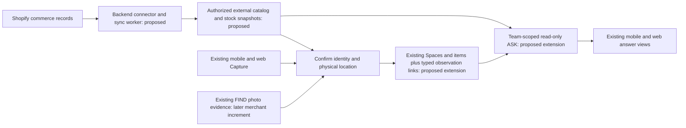

# Shopify as an optional FindEZ connector

Assessment: October 12, 2026 (PDT). Audited source: `fdec959`, including delivered
mobile build 62. Status: discovery and recommendation only. No integration,
migration, merchant connection, pricing change or deployment was implemented.

FindEZ remains **THE AI MEMORY FOR THE PHYSICAL WORLD**: **Know what you have.
Find what you need. Instantly.** Shopify is an additional feature for businesses
that already use it. Adoption should reuse their existing data and reduce repeated
entry. It does not require migrating their commerce operations to FindEZ.

## 1. Verified current state

Reviewed AGENTS, project/architecture/current-state/decisions/active-work/tasks,
CLAUDE and relevant testing guidance. No task handoffs were registered. Inspected
backend routes/services, schema baseline and relevant migrations, Flutter capture,
Review/API models, and web Capture/Review/Ask/item/settings/document clients.

Read-only production queries checked relevant columns, constraints, the external
identity index and storage bucket visibility. No customer rows were read. Deployed
`items_repo.py`, `find_pipeline.py`, `ai_agent.py` and `review_queue.py` fingerprints
match the audited source. Document, Team-workspace and router files differ in the
dirty production checkout; preserve and re-inspect that work before implementation.
No Shopify references were found in current source, the primary checkout,
commit-message history or deployed backend Python. No Shopify/connection/observation
tables were found in the relevant live schema scan. This does not audit external
projects or every historical branch. Production `/openapi.json` returns 404;
that endpoint was not used as proof of available routes.

| Area | What exists | What remains missing for this feature |
| --- | --- | --- |
| Capture and FIND | Real external FIND job upload/run/poll/result/cleanup; segmentation/identity/OCR/barcode/measurement response mapping; retained source/crops when available. [Client](../backend/app/services/find_pipeline.py), [mobile](../mobile/lib/features/scan/upload_photo_flow.dart), [web](../frontend/src/components/site/scan-center-client.tsx). | Merchant-catalog matcher, visual catalog retrieval/embeddings and retail-domain accuracy validation. The external inference engine is not in this repository; its accuracy is not established by the client code. |
| Review | Durable pending records and transactional, idempotent resolution into an item. [Migration 036](../backend/supabase/migrations/036_capture_reviews.sql), [service](../backend/app/services/review_queue.py). | Review currently belongs to a user and resolves to an inventory item. Shared merchant review and confirming a placement without creating stock need explicit support. |
| Physical records | `items` has identity, quantity, `space_id`, `bin_id`, photos, notes, barcode, manufacturer `catalog_id`, `workspace_id`, `source_system`, `external_id`. `spaces` and `bins` are live. | No variant/options model, general storage tree, last-confirmed location, typed movement/observation ledger or separate commerce quantity snapshot. Items have `created_at`, not `updated_at`; creation time is not last confirmation. |
| Import | CSV/XLSX/table parsing and field mapping; scoped public API bulk upsert by external identity. [Parser](../backend/app/services/spreadsheet_import.py), [API](../backend/app/api/routes/api_v1.py). | No Shopify adapter, OAuth, token vault, sync cursor, durable integration job system or store status UI. |
| Collaboration | Existing Teams, memberships, linked Team Spaces and role checks. [Workspace routes](../backend/app/api/routes/team_workspace.py). | Store ownership/delegation policy and connected-store reads for employees. Legacy Shared Spaces and newer Teams are different authorization models. |
| ASK | Live owner/legacy-shared inventory tools, photo identity comparisons, conversation snapshots and bounded Sources. [Agent](../backend/app/services/ai_agent.py), [photo answers](../backend/app/services/ask_photo_questions.py), [presentation](../backend/app/services/ask_presentation.py). | `_inventory_knowledge` does not traverse newer `team_memberships`/`team_spaces`; request schema has no selected commerce/Team context. General Ask also exposes item mutations. Connected-store lookup requires a server-enforced read-only tool set and Team-aware retrieval. |
| Documents/history | Personal documents can link to an item; Team documents and activity exist. Item events support usage/note/failure/success/restock/photo. | Document extraction/AI-consent helpers and live text columns are not an end-to-end document retrieval feature in Ask. Events/activity are not a mandatory transactional audit ledger. No shipment/order relationships or immutable location/count history. |
| AI memory | User facts and similar conversation history are stored. [Memory service](../backend/app/services/ai_memory.py). | Model-extracted conversation facts are supplemental, not verified physical evidence or a business context graph. |

Important reuse constraints:

- `bulk_create_items` aggregates incoming rows by normalized name and can add to
  existing quantities. `add_item` also merges name/location matches. Neither is a
  safe catalog synchronization destination: different variants can collide and a
  retry can add stock again.
- The live unique index is `(workspace_id, source_system, external_id)`. It gives
  useful idempotent import semantics, but one item per external identity cannot
  represent one variant in several bins or several observations of that variant.
- `bin_id` exists in PostgreSQL, but inspected app item-write contracts do not
  expose it. Bin APIs are owner-scoped. Do not advertise working employee bin
  placement until the Team-aware client/API path is implemented and tested.
- `parts_catalog` is a shared manufacturer/parts catalog. A merchant's Shopify
  product is not manufacturer verification. Do not load private merchant products
  into that global catalog or mark them as verified manufacturer matches.
- Full `scan_evidence` survives in Review records; ordinary item creation does
  not preserve the complete evidence payload. Masks/geometry remain temporary.

## 2. Recommended smallest valuable release

**Connect an existing store, bring in its catalog, confirm where a variant is
stored, and ask FindEZ to locate it.** Read-only refers to Shopify: employees may
explicitly save FindEZ physical observations under existing permissions.

The first merchant release includes:

1. Secure store authorization bound to a selected existing FindEZ Team; owner
   manages the connection and explicitly delegates access to that Team.
2. Import/synchronize permitted products, variants/options, SKUs, barcodes,
   catalog image references, inventory-item/location IDs and labeled stock
   snapshots. No automatic inventory item or quantity creation.
3. Match a scanned barcode or selected catalog variant, then explicitly confirm
   a FindEZ Space (and a bin once its API/client gap is closed). Save who confirmed
   it, when, evidence source and revision. A location confirmation can have an
   unknown quantity; do not default it to one unit.
4. Read-only conversational lookup with variant clarification, current accessible
   placements, source/time labels and an honest unknown result.
5. Visible sync/connection status, retry/reconnect, disconnect/uninstall behavior,
   durable webhook processing and scheduled reconciliation.

Photo matching is a subsequent increment unless the media/security gates below
are resolved and a merchant benchmark demonstrates reliability. This gives a
useful first release without depending on whole-stockroom recognition.

Example proposed answer: "Black hoodie, medium: Bin 12 in Stockroom, confirmed
by Alex on Tuesday. Shopify reports 24 available at Warehouse, synced 8 minutes
ago. No complete physical count has been confirmed." These are separate facts.
An old record or multiple candidate variants must produce a qualifier or useful
clarification, not a guessed shelf.

Mobile keeps Capture/FIND/ASK as the main loop. Web adds a small connection/status
panel in the selected Team's settings, import/review controls and links to existing
inventory context. Household users get no extra dashboard or onboarding burden.

## 3. Architecture and data mapping

Use the existing FastAPI backend and Supabase authorization model. Add a bounded
Shopify adapter and durable sync worker behind it. Keep commerce cache data
separate from physical facts, joined through stable identifiers.

| Information | Reuse | Genuine gap / proposed representation |
| --- | --- | --- |
| Business/access boundary | `teams`, `team_memberships`, `team_spaces`; existing member/editor checks | Connection belongs to a chosen Team; every read, worker and confirmation verifies that boundary. Shopify staff membership is not automatically FindEZ membership. |
| Store identity | Existing workspace UUID | Provider + canonical shop GID + installation generation, granted scopes/status; separate encrypted credentials accessible only to backend workers. Never key a store by a mutable display name. |
| Product/variant identity | Existing external identity conventions | Tenant-scoped external catalog cache retains product GID, variant GID, options and inventory-item GID separately. SKU is searchable data, not the primary key or `part_number`. |
| Barcodes | Existing extraction/scanning and `items.barcode` | Merchant-scoped multiple barcode aliases and candidate sets. Preserve strings/leading zeros and distinguish exact decoded evidence from OCR guesses. |
| Product images | Existing image presentation | Catalog images are catalog evidence, not photos proving physical presence. User captures keep their own source/path/provenance. |
| Physical location | `spaces.id`, `items.space_id`, `bins.id`, `items.bin_id` | Explicit link from a catalog variant to a placement/physical item. A Shopify inventory location may map to several FindEZ Spaces/bins; merchants confirm this mapping. |
| Physical facts | Existing item fields, Review evidence, photo events | Typed append-only confirmation/observation records with actor, observed/confirmed time, source, revision and optional count. Link existing items when appropriate; permit a placement with no inventory item/count. |
| Commerce quantity | Existing `items.quantity` remains a FindEZ record | Separate snapshot keyed by shop + inventory-item GID + location GID + quantity-state name, with source update/sync time and tracked/unknown state. Never overwrite `items.quantity` with it. |
| Related files/activity | `documents.item_id`, Team documents, `item_events`, `team_activity`, `messages.answer_context` | Extend typed links/context only for a defined workflow. Require transactional audit events for new confirmations/sensitive actions rather than best-effort summaries. |

These are conceptual additions, not an approved SQL schema. Review the smallest
connection/cache/link/observation design before writing implementation migrations.
Extend existing records where their meaning fits; do not squeeze catalog identity,
quantity observations and placements into one overloaded item row.

For other platforms, reuse a small normalized import contract: provider/store
identity, external IDs, variant attributes, barcode aliases, quantity state/unit,
source timestamp and provenance. Each adapter handles its own authentication and
API semantics. Existing spreadsheet parsing can support a preview/mapping path
for businesses without a connector. Preserve supplied identifiers, preview
conflicts, make re-import idempotent and keep physical annotations. Build only the
Shopify adapter initially; a generic plugin framework is unnecessary.

## 4. Current Shopify compatibility findings

Documentation was verified for this assessment; no authenticated Shopify API call
or merchant installation was performed. Contract-test the exact queries and
granted scopes against a development store before promising fields.

- Use GraphQL Admin API and pin API/webhook version `2026-10`, the documented
  latest stable version. Check returned version headers and track upgrades;
  do not use `latest` as a production runtime endpoint. REST is legacy.
  [Versioning](https://shopify.dev/docs/api/usage/versioning),
  [REST status](https://shopify.dev/docs/api/admin-rest/usage/versioning).
- `ProductVariant` has variant/options identity and a paginated `barcodes`
  connection (up to 20), so a legacy single `barcode` assumption is insufficient.
  [ProductVariant](https://shopify.dev/docs/api/admin-graphql/2026-10/objects/ProductVariant).
- `InventoryItem.sku` is case-sensitive and duplicate SKUs are represented by the
  API. Its `variants` connection means the adapter must not impose a universal
  one-variant-to-one-inventory-item relationship.
  [InventoryItem](https://shopify.dev/docs/api/admin-graphql/2026-10/objects/InventoryItem).
- Inventory levels join inventory items to Shopify locations and expose named
  quantity states, including available and on-hand. These are distinct from a
  timestamped employee count. Products require `read_products`; inventory levels
  require `read_inventory`. Verify whether the chosen location query needs an
  additional `read_locations` grant; Location documents alternative read scopes.
  Request no order/customer/fulfillment/write scopes for this release.
  [Product](https://shopify.dev/docs/api/admin-graphql/2026-10/objects/Product),
  [InventoryLevel](https://shopify.dev/docs/api/admin-graphql/2026-10/objects/InventoryLevel),
  [Location](https://shopify.dev/docs/api/admin-graphql/2026-10/objects/Location).
- Background synchronization needs offline authorization. New public apps must
  use expiring offline tokens for GraphQL; implement refresh, encrypted token
  rotation and serialized renewal per store, reading lifetimes from responses.
  Standalone/API-only authorization-code and embedded token-exchange flows are
  different. Select the distribution/install path first.
  [Tokens](https://shopify.dev/docs/apps/build/authentication-authorization/access-tokens),
  [Standalone auth](https://shopify.dev/docs/apps/build/authentication-authorization/authenticate-standalone-apps).
- GraphQL throttling is cost-based per app/store. Respect returned cost/throttle
  metadata, bound concurrency and back off with jitter. Page every relevant
  connection; use bulk queries later when catalog scale justifies them.
  [Rate limits](https://shopify.dev/docs/apps/build/apis/graphql-admin/rate-limits).
- HTTPS webhooks require raw-body HMAC verification, durable deduplication and a
  fast acknowledgement (five-second total delivery timeout). Use delivery IDs
  to deduplicate and event IDs to correlate. Do not assume ordered/complete
  delivery or use a webhook's abbreviated product payload as a full catalog.
  Queue canonical refreshes and reconcile periodically.
  [Delivery verification](https://shopify.dev/docs/apps/build/webhooks/verify-deliveries),
  [Webhook reference](https://shopify.dev/docs/api/webhooks/latest).
- Custom distribution is limited to a specific store or one Plus organization;
  it is not a shortcut for unrelated merchants. Public distribution requires
  approval. App Store installation rules prohibit asking merchants to type their
  store domain; verify the required Shopify-owned install/embedded experience.
  Keep any Shopify shell thin and reuse FindEZ's backend.
  [Distribution](https://shopify.dev/docs/apps/launch/distribution),
  [App requirements](https://shopify.dev/docs/apps/launch/shopify-app-store/app-store-requirements).

## 5. Phases, dependencies and milestones

| Phase | Concrete milestone | Dependency and exit criteria |
| --- | --- | --- |
| 0: Contract and pilot design | Choose development/pilot distribution, verify actual read queries, scope grants and identity fixtures; interview a merchant about locating stock | Development store/app authorization; agree a representative catalog and baseline picking/search time. No production changes. Approve connection/retention/tenant design. |
| 1A: Connect and bring existing data | Secure owner-bound authorization, isolated catalog cache, restart-safe import, sync status, webhook/reconciliation/disconnect lifecycle; web preview | Approved non-production migrations and credential storage; all pagination and tenant/security tests pass. Import/re-import changes neither physical stock nor annotations. |
| 1B: Locate a confirmed product | Barcode/manual variant selection, explicit Space/bin confirmation, actor/time/evidence, member-authorized read-only Ask and Sources | 1A plus Team retrieval, typed confirmations and bin contract gap where used. This completes the smallest valuable merchant release; connection-only UI does not. |
| 2: Investigate and receive | Employee counts and discrepancy review; user-confirmed shipment groups and packing-slip/document links | Same identity/location/unit/count coverage and time boundaries; document access/text retrieval implemented. No automatic adjustment, receipt or fulfillment claim. |
| 3: Photo-assisted mapping | FIND evidence feeds merchant-catalog candidates; ambiguity review, durable evidence and correction history | Private merchant media and protected transport approved separately; actual retail/label benchmark. No invented masks/crops/confidence or visual count accepted as a stock audit. |
| 4: Additional connectors and approved actions | Reuse proven import contract; picking assistance, then narrowly authorized external adjustments | Demand/cost evidence, new scopes, explicit confirmation, idempotency, concurrency checks, audit and external success verification. Forecasting/enterprise automation stays later. |

No calendar estimate or final tier limits are justified yet. A barcode-first
pilot tests the daily value before costly vision or fulfillment automation.

## 6. Security, reliability and retention plan

- Existing Supabase JWT identity remains the user boundary. Initial connection
  management is owner-only; employee reads/confirmations use the selected Team's
  membership/editor rules. Recheck access on every request, including after
  membership revocation. Do not broaden existing public API-key privileges.
- OAuth state is short-lived, single-use and bound to actor, Team, intended store
  and redirect. Validate Shopify callback HMAC/host, approved redirect and actual
  granted scopes; reject expired/reused/swapped state. Shopify-launched installs
  authenticate Shopify first and use a separate explicit FindEZ account/Team
  linking step. Never use arbitrary client-supplied shop URLs for outbound calls.
- Encrypt access/refresh tokens server-side with a separately managed key and
  versioned rotation. Deny client/API-key reads of credentials and redact logs.
  Send the language gateway only authorized bounded data, never credentials.
- Persist received webhook/job work before acknowledging it. Workers use leases,
  restart-safe cursors, bounded retries, retryable/dead-letter state and store
  isolation. Re-fetch canonical records on change events; prevent older sync
  generations from replacing newer cache state. Resume a partial import without
  declaring the full catalog current; keep last-success distinct from last-attempt.
- Handle 401/scope revocation as reconnect-required, partial GraphQL errors as
  partial/failed work, and network/throttle failures as retryable. A worker checks
  active installation generation before using a token or committing results.
  Disconnect/uninstall invalidates pending jobs and cannot be undone by a late
  webhook or OAuth callback.
- Confirmations atomically store links and audit evidence with actor/idempotency
  key/revision. Imported names/descriptions, OCR and documents are untrusted data;
  they cannot grant permissions or instruct tools. Connected lookup has a backend
  read-only allowlist in streaming and non-streaming paths, not just a prompt.
- Product/location deletion tombstones commerce references; it must not trigger
  deletion of native physical items or Spaces. Ordinary Space deletion retains
  its existing explicit destructive behavior.
- Define Shopify-derived versus independently authored FindEZ data, backup/media
  retention and deletion jobs before launch. App Store apps need all three
  compliance topics even without customer data. `shop/redact` is sent after
  uninstall and requires erasing shop data; retaining everything indefinitely is
  not a valid disconnect design. Preserve only independently retained native
  memory allowed by the explicit policy, remove derived cache/credentials/links
  as required and propagate deletion to derived indexes/media/backups under that
  policy. Obtain policy review rather than promise a blanket exemption.
  [Compliance](https://shopify.dev/docs/apps/build/compliance/privacy-law-compliance).

The live `item-images` bucket is public; `documents` is private. The existing
FIND HTTP transport is a documented, user-deferred risk. This task does not
authorize changing either. Sensitive merchant photos need separately authorized
private media and transport work before the photo-assisted increment. Existing
best-effort activity logs must not serve as the sole audit for new sensitive actions.

## 7. First-release acceptance criteria and tradeoffs

The first merchant release is complete only when an authorized development/pilot
store demonstrates all of the following, not just a working interface:

1. Owner can connect the intended store to the intended Team; wrong actor/Team,
   unauthorized viewer, forged callback and replay fail. No token appears in
   clients, model prompts, logs or ordinary API responses.
2. Full permitted catalog imports across pagination; repeat, interrupted import
   and webhook duplicates retain stable identities and add no physical quantity.
   Tests include identical titles, missing/duplicate/case-sensitive SKUs, multiple
   barcodes, several variants and multiple stores with overlapping identifiers.
3. Same variant can have several confirmed placements, and one placement can
   hold different variants. No catalog-only record is shown as a confirmed
   physical item or false out-of-stock Home card. Unknown/untracked stock is not zero.
4. Employee confirms a real location, reloads and sees actor/time/source/revision.
   A repeated confirmation creates no duplicate event. Failed saves remain visible
   and retryable. Simultaneous moves preserve history or surface a revision conflict.
5. Ask resolves the correct variant and only accessible current placements. Tests
   force clarification for ambiguous size/color/location, unknown and stale facts,
   deleted variants, revoked membership and account changes. Cached conversation
   facts never substitute for a fresh authorized lookup.
6. Shopify quantity state/location/sync time and employee-observed count/time are
   separate. No inference of stock availability from a photo or catalog presence,
   no comparison of available with a partial on-hand count, and no Shopify write.
7. Restart, throttling, partial GraphQL errors, delayed/out-of-order webhooks,
   expired tokens and lost deliveries recover with honest status. Uninstall,
   reconnect and disconnect races cannot revive old access. Retention/compliance
   behavior is tested with an independently retained native item.
8. Existing backend, Flutter, web, connector and PostgreSQL suites remain green;
   new owner/Team/store isolation SQL tests use disposable databases. Physical
   barcode/lookup and browser-install acceptance are recorded separately from mocks.

Principal tradeoffs: accurate variants and provenance need a small new model;
writing directly into existing items would be quicker but corrupts meaning.
Barcode/manual confirmation is narrower than full scene recognition but reliable
enough to validate locating value. Quantity discrepancies require comparable
coverage/time/unit and do not prove either system is wrong. Catalog synchronization
should not overwrite corrected names/notes, movement evidence or physical counts.

Measure time to first usable catalog, manual re-entry avoided, time to locate/pick
a target, successful grounded lookup, ambiguity/correction rate, stale placements,
sync lag/failure recovery and repeat employee use. Agree improvement targets with
the pilot merchant and measure willingness to pay; do not advertise unmeasured gains.

## 8. Commercial boundaries and next implementation task

Preserve the user-provided direction: Free $0; Pro $19/month or $149/year; Team
$99/month or $790/year; Business $299/month or $2,490/year; Enterprise custom.
No pricing, pilot/payment behavior, arbitrary limits or plan entitlements change
in this pass. Existing legacy pricing/payment code does not establish that these
tiers are fully implemented. Shopify App Store distribution also has billing
requirements; determine the permitted charging path before listing or selling the
connector, while preserving FindEZ's commercial direction.
[Shopify billing](https://shopify.dev/docs/apps/launch/billing).

Recommended next task: **build the read-only catalog-onboarding milestone 1A in
an isolated non-production environment**. After selecting the app/distribution
path, implement validated authorization, encrypted credentials, paginated variant
import with stable identifiers and a minimal existing-web-settings preview/status
panel. Include durable sync/disconnect tests and deliberately leave normal
inventory untouched. It removes catalog re-entry and establishes the foundation
for 1B; it is not yet the complete locating release.

The following task is the narrow 1B vertical slice: select/scan one imported
variant, confirm its existing Space, persist a typed observation and retrieve
that location from employee-authorized Ask. Production migrations/deployments and
merchant installations require separate explicit authorization. No Shopify
integration capability is implemented or enabled by this report.
