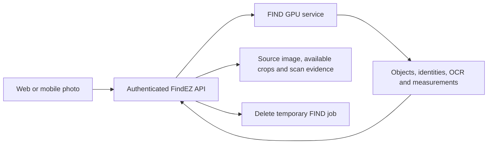
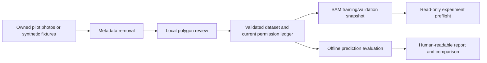

# Current architecture and preparation boundary

Date: 2026-10-19. Source checkout base: `05f4eed`.
Earlier live observations are historical evidence, not a fresh server audit.
No server connections were needed for this local implementation.

## Existing photo path

The local source of truth for this path is
`backend/app/services/find_pipeline.py`. The shared architecture notes describe
the same cleanup boundary. Source images and available crops survive; full
segmentation masks, complete coordinate transforms and exact model provenance
are not currently stored as training records. Inventory edits and memory
settings do not constitute training consent.

Chat uses a separate backend gateway and scoped inventory tools. It is not the
photo segmentation model. This work does not change chat, web, mobile or the API.

## Confirmed models and reproducibility records

Tanya confirms the model identities in the training plan are exact. Use those
identities as the starting point; do not ask the operator to rediscover or choose
different model families. Weight hashes and runtime settings are still needed
to reproduce a particular experiment and support rollback.

| Component | Confirmed model / earlier service report | Remaining reproducibility details |
| --- | --- | --- |
| Segmentation | `facebook/sam2.1-hiera-large` | Actual weight SHA256, source commit, prompts, preprocessing and runtime config |
| Depth | `depth-anything/Depth-Anything-V2-Base-hf` | Exact weights, license basis and effect on downstream crops |
| Recognition | Qwen3-VL-8B (`qwen3-vl-8b`) | Weight hash, quantization, adapter and serving revisions |
| Difficult OCR | HunyuanOCR (`hunyuanocr-dflash` service) | Weight hash, wrapper revision and applicable license arrangements |
| Bulk OCR | CUDA-backed OCR service | Exact engine, model and revision |
| Chat | `deepseek-v4-flash-agent` route through the FTCTools gateway | Actual weights behind the alias and gateway configuration |
| Hardware | NVIDIA RTX PRO 6000 Blackwell Workstation Edition was reported | Device count, reserved memory, training allocation, installed driver/CUDA/PyTorch and spare capacity |

The first handoff asks the operator for immutable versions and configuration so
results can be repeated. Model identity is already confirmed; a checkpoint hash
distinguishes one saved set of weights from a later fine-tuned version.

## What this branch implements

All arrows here are local files or loopback browser requests. There is no SSH
client, background collector, training worker, remote upload or deployment action
in the toolkit. Production customer collection is a design in this branch,
not an implemented feature.

## Dependencies to resolve before a real experiment

1. Obtain the FIND source/configuration contract and hashes for the confirmed models.
2. Resolve model and output-use licensing for the intended deployment and
   derivative datasets.
3. Establish approved GPU capacity and an isolated environment.
4. Make independently labeled, rights-reviewed real-image benchmarks.
5. Have the operator run a small baseline and return predictions in the shared
   format. Debug transforms and masks before spending time training.
6. Only then run the targeted SAM experiment and compare it with the baseline.

## Transport remains a separate launch task

The earlier review found an unencrypted application-to-FIND processing hop.
This local preparation does not repair it. Ask the operator for authenticated
TLS with certificate verification or an approved encrypted private transport.
Moving training code to a GPU does not fix inference transport security.

## License questions to resolve

The official [Depth Anything V2 license section](https://github.com/DepthAnything/Depth-Anything-V2#license)
lists Base/Large/Giant under CC-BY-NC-4.0 and Small under Apache 2.0.
Record the deployed weights and any separate commercial agreement before
continuing commercial use or derivative work. Switching to Small would need
its own quality evaluation.

The [HunyuanOCR license](https://github.com/Tencent-Hunyuan/HunyuanOCR/blob/main/LICENSE)
contains geographic and output-use restrictions. Record the applicable agreement
for the confirmed HunyuanOCR deployment and intended use. In particular, do
not assume Hunyuan-derived labels may train Qwen merely because a person
reviewed them. This pilot blocks model-assisted labels from training exports.

These are unresolved technical procurement questions, not a determination that
a particular deployment has or lacks a separate license.
